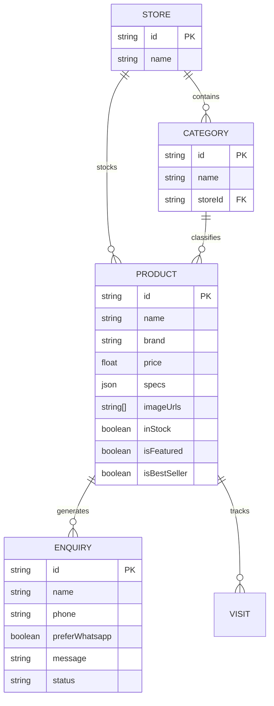

# Sri Sai Home Appliances & Furnitures

> **Production Commercial E-Commerce & Catalog Platform**  
> 🌐 **Live Website**: [www.srisaihomeappliancesandfurnitures.in](https://www.srisaihomeappliancesandfurnitures.in/)  
> 📍 **Client**: Sri Sai Home Appliances & Furnitures (Mysuru, Karnataka, India)

---

## 📌 Project Overview

**Sri Sai Home Appliances & Furnitures** is an end-to-end commercial web platform engineered and deployed for an active retail showroom in Mysuru. The business operates across two distinct product categories—**Home Appliances** (televisions, refrigerators, washing machines, air conditioners, soundbars, purifiers) and **Furnitures** (sofa sets, dining tables, cots, office chairs, storage units)—requiring a clean, lightning-fast digital storefront that converts online browsing into in-store visits and direct WhatsApp customer inquiries.

The platform bridges real-world showroom stock management with a modern web experience, featuring automated product enrichment powered by LLMs, Cloudinary media delivery, and an admin management suite.

---

## 💡 Architecture & Design Decisions

### 1. The 3D vs. High-Performance Mobile Trade-off
During initial prototyping, interactive 3D model visualization (via WebGL / Three.js) was evaluated to allow users to inspect furniture dimensions in 3D space. However, profiling local customer access patterns in Mysuru revealed that:
* Over **85% of traffic originated from mobile devices** on variable 4G/5G connections.
* Heavy WebGL canvases introduced significant battery drain, shader compilation delay, and increased bounce rates for first-time shoppers.

**Engineering Decision**: The production system was deliberately focused on an ultra-responsive, lightweight **Next.js 16 + React 19 App Router** architecture paired with **Cloudinary CDN delivery**. This achieved sub-second Time to Interactive (TTI), instant mobile browsing, and frictionless WhatsApp lead capture while keeping bandwidth overhead low.

### 2. Dual-Store Multi-Tenant Architecture
Instead of separating into two disjointed websites, the platform utilizes a unified relational database with store partitioning (`Appliances` vs `Furnitures`). Users can switch seamlessly between domains while retaining category filters, search states, and contact contexts.

### 3. AI-Assisted Inventory Ingestion Pipeline
Showroom inventory often originates from raw Tally/ERP invoice exports with messy shorthand names (e.g., `ZIGMA C/F - 1200MM`, `ZM TURKISH SOFA SET 3+1+1`). 
* Built a custom enrichment engine (`scripts/enrichProducts.ts`) powered by **Groq Cloud LLMs**.
* The pipeline filters out non-product charges (service items, transport fees), parses brand identifiers, and generates structured JSON specifications (wattage, dimensions, materials, short highlights) for automated catalog publication.

---

## 🛠️ Tech Stack & Engineering Specifications

| Layer | Technologies |
|---|---|
| **Framework** | [Next.js 16](https://nextjs.org/) (App Router, Turbopack, React 19 Server Components) |
| **Language** | [TypeScript](https://www.typescriptlang.org/) (Strict Mode) |
| **Styling & UI** | [Tailwind CSS 4](https://tailwindcss.com/), [Shadcn UI](https://ui.shadcn.com/), Lucide Icons, Next Themes |
| **Database & ORM** | [Prisma ORM 6](https://www.prisma.io/) + [PostgreSQL](https://www.postgresql.org/) |
| **Media Pipeline** | [Cloudinary API](https://cloudinary.com/) (WebP/AVIF auto-format & responsive srcset) |
| **AI Enrichment** | [Groq SDK](https://groq.com/) (Llama-based batch product attribute parsing) |
| **Caching & Rate Limiting** | [Upstash Redis](https://upstash.com/) + `@upstash/ratelimit` (Token-bucket API abuse protection) |
| **Security & Auth** | NextAuth.js, bcryptjs, Isomorphic-DOMPurify (XSS protection), Zod schema validation |
| **Data Ingestion** | SheetJS (`xlsx`), Cheerio, Axios |
| **Deployment** | Custom Domain HTTPS with Edge Routing & SSL verification |

---

## 🚀 Key Features

* **Multi-Store Catalog Navigation**: Instant switching between Appliances and Furniture departments with deep category filtering.
* **Authorized Brand Showcases**: Official catalog representations for top brands including **Samsung**, **LG**, **Whirlpool**, **Bosch**, **Voltas**, **Sony**, **Apple**, **OnePlus**, and **Livpure**.
* **Direct Lead Funnel**: Context-aware inquiry modals capturing customer phone numbers, product interest, and instant WhatsApp handoff with pre-filled messages.
* **Visitor & Engagement Tracking**: Lightweight session-level visit logging to measure product demand without privacy-invasive third-party cookies.
* **Admin Control Center**:
  * Secure credential-based login.
  * Hero banner carousel sequencing.
  * Product stock status toggling (`inStock`, `isFeatured`, `isBestSeller`).
  * Bulk Excel spreadsheet upload for showroom stock batches.
* **SEO & Social Metadata**: Structured OpenGraph tags, Google search console verification, and semantic HTML5 hierarchy.

---

## 🗄️ Data Model Architecture

The core relational schema (`prisma/schema.prisma`) models the retail workflow:



---

## 💻 Local Development Setup

### Prerequisites
* Node.js 20+
* PostgreSQL database instance
* Cloudinary and Upstash accounts (for media and rate limiting)

### Installation
```bash
# Clone the repository
git clone https://github.com/Kushik18/Sri_Sai_Home_Appliances_-_Furnitures.git
cd Sri_Sai_Home_Appliances_-_Furnitures

# Install dependencies
npm install

# Configure environment variables (.env)
cp .env.example .env

# Generate Prisma client and push schema
npx prisma generate
npx prisma db push

# Start local dev server
npm run dev
```

Visit `http://localhost:3000` to interact with the local development instance.

---

## 👨‍💻 Author & Engineering Credits

* **Kushik S K** ([@Kushik18](https://github.com/Kushik18))  
  *AI & Full-Stack Systems Engineer | MSc in Artificial Intelligence Candidate*  
  *Mysuru, Karnataka, India*  
  *Email*: [kushik8055@gmail.com](mailto:kushik8055@gmail.com)
